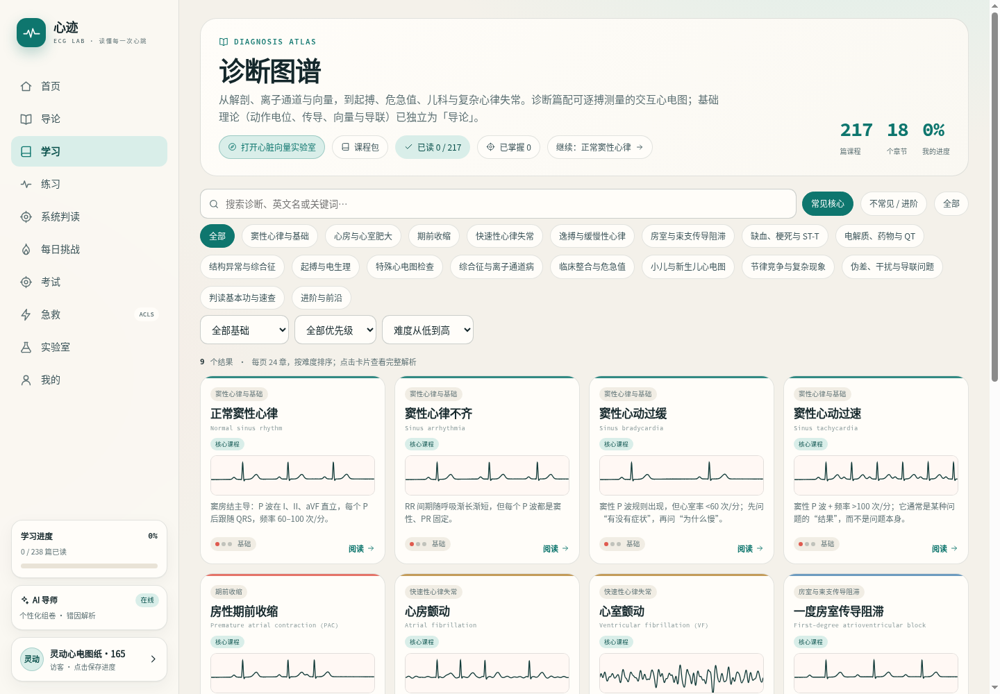
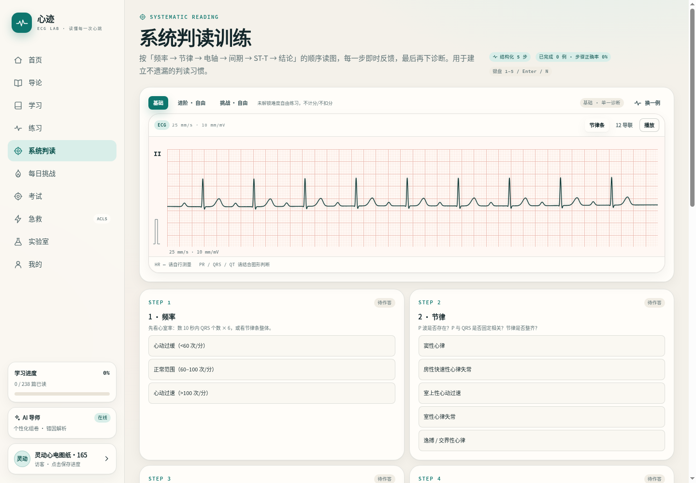
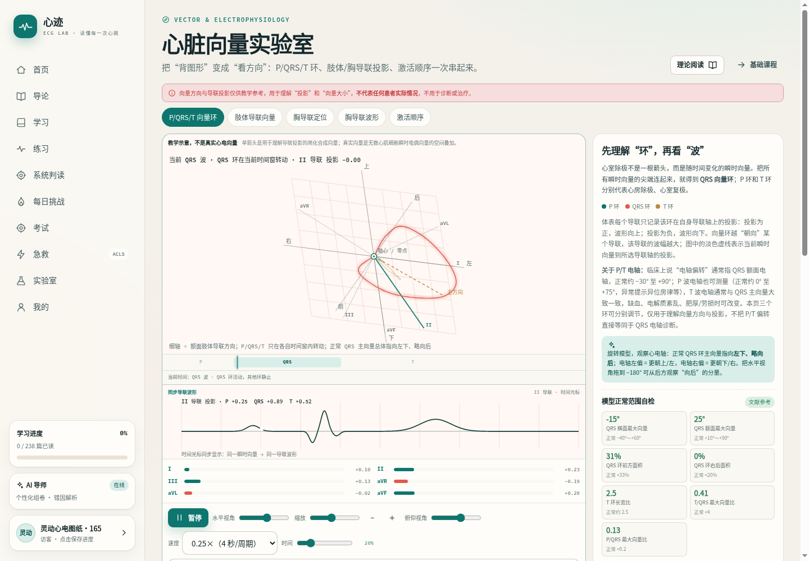

+++
date = '2026-11-12T10:00:00+08:00'
draft = false
title = 'ECG Lab: An Interactive Electrocardiogram Learning Platform'
tags = ["ECG", "Medical Education", "Open Source", "PHP", "Interactive Learning"]
categories = ["Project", "Tech"]
description = "Introducing ECG Lab - an interactive electrocardiogram learning platform for medical students and clinicians, featuring systematic courses, practice exercises, and simulation tests."
image = "/uploads/ecg-lab-screenshot.png"
+++

## Project Background

ECG interpretation is a core clinical skill, but traditional learning methods often rely on static images and lengthy text, presenting several pain points:

- 📱 Grid lines are hard to see on mobile devices, making waveform measurement difficult
- 📚 Practice and learning are disconnected, with no immediate feedback after studying theory
- 🎯 Emergency procedures can only be memorized through videos, lacking interactive training

**ECG Lab** was created to solve these problems.

## Core Features

### 📚 Systematic Learning

- **238 chapters**: Covering electrophysiology, leads & vectors, atrial/ventricular hypertrophy, ischemia & infarction, electrolytes & medications, and more
- **Interactive ECG waveforms**: 500 Hz sampling rate, supporting rhythm strips/12-lead display, loop/continuous scrolling, annotation and hover measurement
- **Bilingual support**: All content available in Chinese and English

### ✍️ Practice Exercises

- **Systematic interpretation training**: Six-step reading (rate→rhythm→axis→intervals→ST-T→conclusion) with step-by-step feedback
- **2000+ practice questions**: Covering 42 diagnoses, with chapter filtering and multi-select support
- **Three game modes**: Classic interpretation, Speed 60s, Combo survival
- **Adaptive spaced repetition**: Error log tracks confused options, with 1→3→8→20 day intervals

### 🎯 Simulation Tests

- **ACLS emergency simulation**: 12 server-side state machine scenarios, CPR quality, defibrillation/cardioversion, drug timing training
- **ECG viewer**: Supports zoom, measurement and annotation, analyzing real ECGs like in clinical practice

### 🔬 Laboratory

- **Cardiac Vector Lab**: P/QRS/T 3D vector loops, hexaxial and limb lead projections, precordial lead positioning
- **Electrolyte Lab**: K⁺/Ca²⁺/Mg²⁺ sliders with real-time waveform changes
- **Daily Challenge**: 10 site-wide questions, continuous check-in calendar

## Tech Stack

### Backend
- **PHP 8.4** (no framework, native implementation)
- **MySQL 8+**
- **PDO MySQL**
- **AES-256-GCM tokens**
- **WebAuthn Passkey**

### Frontend
- **Native ES Modules** (zero build tools)
- **Canvas / SVG** waveform rendering
- **Service Worker** (PWA offline support)

### Highlights
- Zero build for frontend and backend, no webpack/vite dependencies
- Teaching-first design, all waveforms marked as "educational illustrations"
- BYOK (Bring Your Own Key) AI integration support

## Project Highlights

### 🎨 Interactive Design

Traditional ECG learning is "look at pictures and talk", ECG Lab lets you **operate hands-on**:
- Drag sliders to change electrolyte concentrations, observe waveform changes in real-time
- Click anywhere on the waveform to measure intervals and amplitudes
- Rotate 3D cardiac vector loops to understand spatial projections

### 📊 Intelligent Assessment

- **XP level system**: Lv.1-20, unlocking different difficulty levels
- **Ability radar chart**: Visualize mastery of each chapter
- **Error analysis**: AI explains differential points for wrong options (unlocked at Lv.10)

### 🌍 Open Source & Free

- Code licensed under [MIT](https://github.com/AndroidOL/ecg-academy)
- Educational content under CC BY-SA 4.0
- Full access without login required

## User Experience

🔗 **Live Demo**: [ecg.tianhao.me](https://ecg.tianhao.me)

- Desktop and mobile responsive
- PWA installable to home screen, offline capable
- Dual themes (light/dark), Chinese/English interface switching

## Project Screenshots

*System learning interface: Course map and chapter navigation*

*Interactive waveforms: Zoom, measure, annotate*

*Cardiac Vector Lab: 3D vector loop visualization*

## Future Roadmap

- 📱 WFDB/SCP format adaptation for real ECG data
- 🎓 CME (Continuing Medical Education) assessment system
- 🤖 Enhanced AI tutor supporting more clinical scenario Q&A
- 📊 Waveform annotator for custom key point marking

## Summary

ECG Lab is my exploration in medical education, attempting to solve traditional ECG learning pain points with modern web technologies. The project uses a zero-build native tech stack, focusing on interactivity and teaching experience, hoping to provide medical students and clinicians with an efficient and engaging learning tool.

Welcome to try it and provide feedback!

---

**Repository**: [github.com/AndroidOL/ecg-academy](https://github.com/AndroidOL/ecg-academy)  
**Live Site**: [ecg.tianhao.me](https://ecg.tianhao.me)
