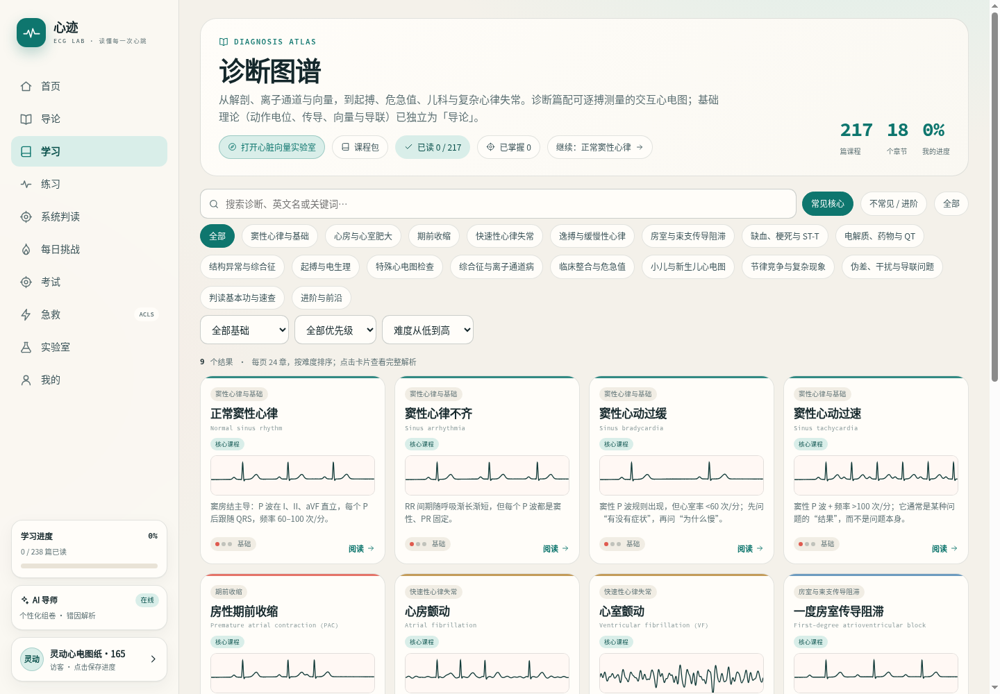
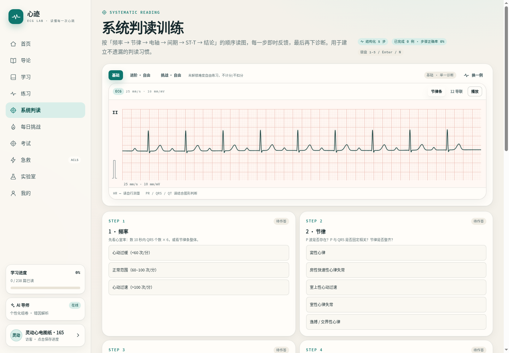
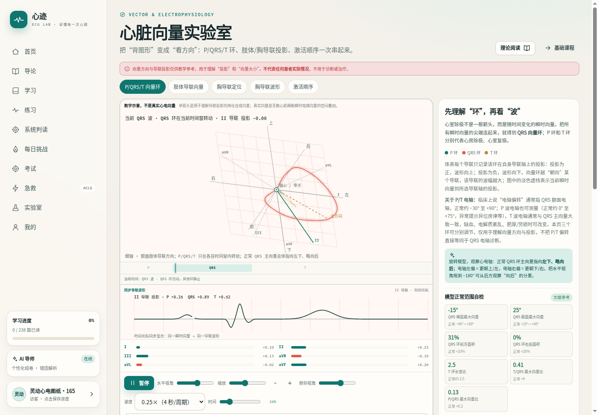

+++
date = '2026-11-12T10:00:00+08:00'
draft = false
title = 'ECG Lab 心迹实验室：交互式心电图学习平台'
tags = ["心电图", "医学教育", "开源项目", "PHP", "交互式学习"]
categories = ["项目", "技术"]
description = "介绍 ECG Lab 心迹实验室项目——一个面向医学生和临床医生的交互式心电图学习平台，支持系统化课程、实践练习和模拟测试。"
image = "/uploads/ecg-lab-screenshot.png"
+++

## 项目背景

心电图（ECG）解读是临床医生的核心技能之一，但传统学习方式往往依赖静态图片和大量文字，存在以下痛点：

- 📱 手机上看不清网格，无法仔细测量波形
- 📚 练习与学习割裂，学完理论找不到即时反馈的题目
- 🎯 急救流程只能靠视频记忆，缺乏交互式训练

**ECG Lab 心迹实验室**就是为了解决这些问题而诞生的。

## 核心功能

### 📚 系统学习

- **238 章系统课程**：涵盖电生理、导联与向量、心房/心室肥大、缺血与梗死、电解质与药物等
- **可交互 ECG 波形**：500 Hz 采样率，支持节律条/12 导联显示、循环覆盖/连续滚动、标注与悬停测量
- **双语支持**：所有内容提供中英文版本，方便不同语言背景的学习者

### ✍️ 实践练习

- **系统判读训练**：按频率→节律→电轴→间期→ST-T→结论六步读图，逐步反馈
- **2000+ 道练习题**：覆盖 42 种诊断，支持章节筛选与多选
- **三种玩法**：经典判读、极速 60 秒、连击生存
- **自适应间隔复习**：错题本记录混淆项，1→3→8→20 天间隔复习

### 🎯 模拟测试

- **ACLS 急救模拟**：12 个服务端状态机场景，CPR 质量、除颤/复律、药物时序训练
- **心电图查看器**：支持缩放、测量和标注，像临床工作中一样分析真实心电图

### 🔬 实验室

- **心脏向量实验室**：P/QRS/T 三维向量环、六轴与肢体导联投影、胸导联定位
- **电解质实验室**：K⁺/Ca²⁺/Mg²⁺滑杆与实时波形变化
- **每日挑战**：全站同题 10 题，连续打卡日历

## 技术栈

### 后端
- **PHP 8.4**（无框架，原生实现）
- **MySQL 8+**
- **PDO MySQL**
- **AES-256-GCM 令牌**
- **WebAuthn Passkey**

### 前端
- **原生 ES Modules**（零构建工具）
- **Canvas / SVG** 波形渲染
- **Service Worker**（PWA 离线支持）

### 特色
- 前后端零构建，不依赖 webpack/vite 等工具
- 教学优先设计，所有波形标注"教学示意"
- 支持 BYOK（Bring Your Own Key）自有 AI 接入

## 项目亮点

### 🎨 交互式设计

传统心电图学习是"看图说话"，ECG Lab 让你**亲手操作**：
- 拖动滑杆改变电解质浓度，实时观察波形变化
- 点击波形任意位置测量间期和振幅
- 三维旋转心脏向量环，理解空间投影

### 📊 智能评估

- **XP 等级系统**：Lv.1-20，对应不同难度解锁
- **能力雷达图**：可视化展示各章节掌握程度
- **错题分析**：AI 针对错选项讲解鉴别点（Lv.10 解锁）

### 🌍 开源免费

- 代码 [MIT](https://github.com/AndroidOL/ecg-academy) 开源
- 教学内容 CC BY-SA 4.0 授权
- 无需登录即可完整学习

## 访问体验

🔗 **在线体验**：[ecg.tianhao.me](https://ecg.tianhao.me)

- 支持桌面和移动设备
- PWA 安装到主屏幕，离线可用
- 深浅双主题，中英文界面切换

## 项目截图

*系统学习界面：课程图谱与章节导航*

*可交互波形：缩放、测量、标注*

*心脏向量实验室：三维向量环可视化*

## 后续规划

- 📱 WFDB/SCP 格式适配，支持真实心电图数据
- 🎓 CME（继续医学教育）评估体系
- 🤖 AI 导师增强，支持更多临床场景问答
- 📊 波形标注器，用户可自定义标记关键点

## 总结

ECG Lab 心迹实验室是我在医学教育领域的一次探索，试图用现代 Web 技术解决传统心电图学习的痛点。项目采用零构建的原生技术栈，注重交互性和教学体验，希望能为医学生和临床医生提供一个高效、有趣的学习工具。

欢迎体验并提出建议！

---

**项目地址**：[github.com/AndroidOL/ecg-academy](https://github.com/AndroidOL/ecg-academy)  
**在线访问**：[ecg.tianhao.me](https://ecg.tianhao.me)
